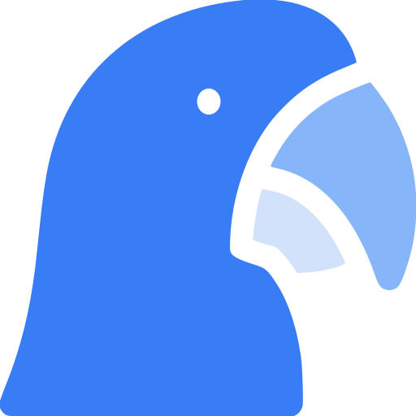
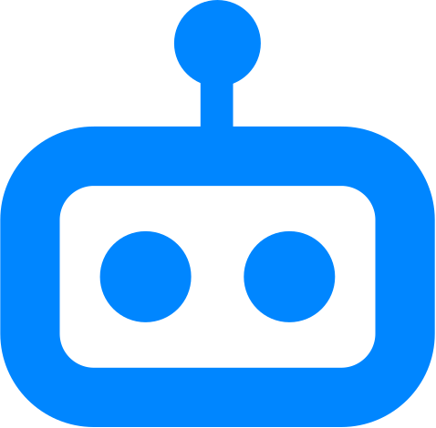

  <b>Full-Stack Developer | SEO Specialist | AI & Automation</b> 
  Ipatinga, Minas Gerais, Brazil 

  
  

## About me

Pragmatic, results-driven full-stack developer with **4+ years** of experience building large-scale products for the education and healthcare sectors. I own the whole product cycle, from concept and architecture to infrastructure and delivery.

- <picture><source media="(prefers-color-scheme: dark)" srcset="./assets/arara-code-white.svg"></picture>&nbsp; Currently working on **[Arara Code](https://arara.code.app.br)**
- <picture><source media="(prefers-color-scheme: dark)" srcset="./assets/rbot-white.svg"></picture>&nbsp; Focused on integrating **AI and automation** into real products
- <picture><source media="(prefers-color-scheme: dark)" srcset="./assets/icons/shield-check-white.svg"></picture>&nbsp; Doing security-oriented QA, especially on systems built with AI assistance
- <picture><source media="(prefers-color-scheme: dark)" srcset="./assets/icons/briefcase-white.svg"></picture>&nbsp; Open to freelance projects and full-time positions

## Featured projects

| Project | Description |
| --- | --- |
| [Arara Code](https://arara.code.app.br) | What I'm building right now. |
| [RBot](https://rbot.com.br) | SaaS for humanized mass WhatsApp messaging using multiple LLMs, vector knowledge and 50+ simultaneous chips. **2,650% ROI.** |
| [Copiei.com](https://copiei.com) | Instant, temporary universal clipboard between devices via 4-digit code or QR, self-destructing after 2 minutes. No sign-up. |
| WhatsApp CRM Extension | WhatsApp Web extension integrated with an institution's CRM: reminders, image editor, real-time notifications and scheduled follow-ups. |
| Educational AI Agent | Infrastructure for an AI assistant providing personalized student support in distance learning. |

## Tech stack

**Languages & Frameworks**

**Infra, DevOps & Data**

**Testing & Monitoring**

---

<i>AI is an excellent tool, but no tool replaces someone who understands the solution they're building.</i>

